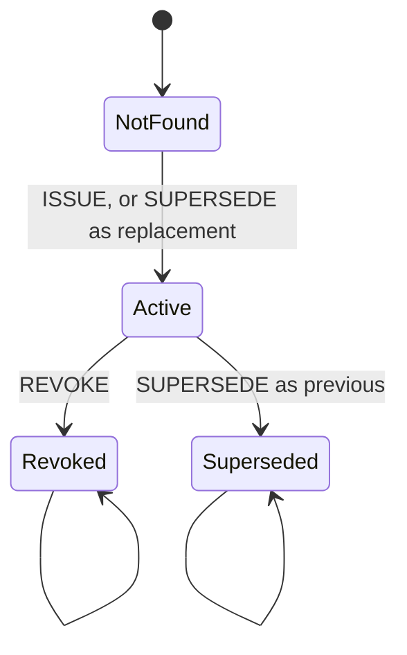

# Proof of Review Specification, protocol v1

Status: describes what is **implemented and tested** in this repository. It is derived from the
source files named in each section, at source revision `b841626` (`git rev-parse b841626`). Anything
not implemented is listed under [Non-goals](#13-versioning-and-non-goals) or in
[Discrepancies found](#14-discrepancies-found), never promoted to a guarantee.

Proof of Review is the primitive. LexAegis is its reference application. Names such as
`lexaegis.review-package.v1` are frozen v1 identifiers and are not renamed.

Drift is checked by `pnpm spec:check`, which compares the tagged literals, tables and snippets below
with the code, the registry source and the committed ABI artifact. Tags are HTML comments
(`<!-- spec:... -->`) and do not render.

## 1. Conventions and terminology

The key words MUST, MUST NOT, SHOULD and MAY are used as in RFC 2119 and only for implemented
behaviour. Each requirement is one of three kinds:

- **Protocol rule**: part of the v1 wire format, hash construction or registry. Changing it needs a
  new protocol version.
- **Profile rule**: belongs to an application profile (for example
  `lexaegis.employment-settlement.ew`). v1 does not evaluate profile semantics.
- **Implementation limit**: a bound the reference implementation enforces.

| Term              | Meaning                                                                                                                           |
| ----------------- | --------------------------------------------------------------------------------------------------------------------------------- |
| Artifact          | One file of the reviewed work, as exact original bytes.                                                                           |
| Manifest          | `ReviewPackageV1`: the metadata that names every artifact and binds chain, registry, reviewer and an optional predecessor.        |
| Opening           | `CommitmentOpeningV1`: the manifest plus the blinding nonce. Private.                                                             |
| Commitment        | A SHA-256 hash that binds the manifest and the nonce. It is not encryption.                                                       |
| Receipt reference | `ReceiptReferenceV1`: the only public object: chain, registry, reviewer, commitment.                                              |
| Receipt           | The registry record for `(reviewer, commitment)`.                                                                                 |
| Reviewer          | The account whose EIP-712 signature authorizes an action. Not necessarily the transaction sender.                                 |
| Executor          | The account that submits the transaction. It has no authority of its own.                                                         |
| Readable export   | `ReviewExportV1`: a private file that carries the opening and the original artifact bytes.                                        |
| Independent       | An expected reference the recipient obtained outside the file being checked. A reference copied from the file is `file-declared`. |

Serialized lifecycle value `not_found` is the registry's `NotFound` state. Other documents may write
"notFound"; the serialized value never changes.

## 2. Layers

1. **Package layer** (`@lexaegis/protocol/v1`): strict import, canonical bytes, digests, commitment,
   offline verification. No network.
2. **Portable layer** (`@lexaegis/protocol/portable`): the readable export envelope and its bounded
   decoder.
3. **Registry layer** (`contracts/src`, `@lexaegis/sdk/registry`): receipts, EIP-712 actions, nonces.
4. **Verification layer** (`@lexaegis/sdk`): offline modes, live checks at a checkpoint, report.

## 3. Data types

Sources: `packages/protocol/src/v1/{primitives,schemas,constants}.ts`.

### 3.1 Primitives

Every primitive is validated, never normalized: a value is accepted exactly as written or rejected.
Hexadecimal text is lowercase only. Large integers are canonical decimal strings; they MUST NOT pass
through a JavaScript `Number`.

| Primitive         | Rule (regular expression)                                                                                          |
| ----------------- | ------------------------------------------------------------------------------------------------------------------ |
| `uuid`            | `^[0-9a-f]{8}-[0-9a-f]{4}-4[0-9a-f]{3}-[89ab][0-9a-f]{3}-[0-9a-f]{12}$` <!-- spec:pattern uuid -->                 |
| `address`         | `^0x[0-9a-f]{40}$` <!-- spec:pattern address --> and, for registry and reviewer, not the zero address              |
| `digest`          | `^0x[0-9a-f]{64}$` <!-- spec:pattern digest -->                                                                    |
| `blindingNonce`   | `^0x[0-9a-f]{64}$` <!-- spec:pattern blindingNonce -->                                                             |
| `unsignedDecimal` | `^(?:0\|[1-9][0-9]*)$` <!-- spec:pattern unsignedDecimal -->                                                       |
| `chainId`         | `^[1-9][0-9]*$` <!-- spec:pattern chainId -->, at most 78 characters, at most 2^256 - 1                            |
| `timestamp`       | `YYYY-MM-DDTHH:mm:ss.sssZ`, a valid UTC instant, exactly millisecond precision                                     |
| `profileId`       | `^[a-z0-9.-]{1,80}$` <!-- spec:pattern profileId -->                                                               |
| `profileVersion`  | `^[1-9][0-9]*$` <!-- spec:pattern profileVersion -->                                                               |
| `mediaType`       | `^[a-z0-9][a-z0-9!#$&^_.+-]*\/[a-z0-9][a-z0-9!#$&^_.+-]*$` <!-- spec:pattern mediaType -->, at most 127 characters |
| `label`           | at most 256 Unicode code points, no lone surrogates, may be empty; `null` is allowed where the field is nullable   |

### 3.2 Identifiers and constants (protocol rules)

| Name              | Value                                                                   |
| ----------------- | ----------------------------------------------------------------------- |
| Package schema    | `lexaegis.review-package.v1` <!-- spec:literal PACKAGE_SCHEMA -->       |
| Reference schema  | `lexaegis.receipt-ref.v1` <!-- spec:literal REFERENCE_SCHEMA -->        |
| Opening schema    | `lexaegis.opening.v1` <!-- spec:literal OPENING_SCHEMA -->              |
| Export schema     | `lexaegis.review-export.v1` <!-- spec:literal REVIEW_EXPORT_SCHEMA -->  |
| Approval intent   | `approve-review-package` <!-- spec:literal APPROVAL_INTENT -->          |
| Package domain    | `lexaegis:review-package:v1` <!-- spec:literal PACKAGE_DOMAIN -->       |
| Commitment domain | `lexaegis:review-commitment:v1` <!-- spec:literal COMMITMENT_DOMAIN --> |

Artifact roles (MUST be one of):

<!-- spec:list ARTIFACT_ROLES -->

- `source`
- `extracted-text`
- `evidence`
- `analysis`
- `calculation`
- `rule-pack`
- `checklist`
- `agent-config`
- `decision-log`

### 3.3 `ArtifactRefV1`

<!-- spec:fields ArtifactRefV1 -->

| Field        | Type              | Constraint                                        |
| ------------ | ----------------- | ------------------------------------------------- |
| `id`         | `uuid`            | unique in the manifest                            |
| `role`       | role              | one of the roles above                            |
| `mediaType`  | `mediaType`       |                                                   |
| `label`      | `label` or `null` | private; never copied to a public object          |
| `byteLength` | `unsignedDecimal` | at most 10485760 (decimal string, never a number) |
| `sha256`     | `digest`          | SHA-256 of the exact original artifact bytes      |

### 3.4 `ReviewPackageV1` (the manifest)

<!-- spec:fields ReviewPackageV1 -->

| Field        | Type                           | Constraint                                                           |
| ------------ | ------------------------------ | -------------------------------------------------------------------- |
| `schema`     | literal                        | exactly the package schema                                           |
| `packageId`  | `uuid`                         |                                                                      |
| `preparedAt` | `timestamp`                    | supplied by the application; not proof of when a review happened     |
| `profile`    | object                         | `{ id, version }`                                                    |
| `context`    | object                         | `{ chainId, registryAddress, reviewerAddress }`                      |
| `supersedes` | `ReceiptReferenceV1` or `null` | declared intended predecessor; does not prove the predecessor exists |
| `artifacts`  | array of `ArtifactRefV1`       | at most 128; array order is committed data                           |
| `approval`   | object                         | `{ intent, scopeArtifactIds, decisionLogArtifactId }`                |

<!-- spec:fields ReviewPackageV1.profile -->

| Field     | Type             |
| --------- | ---------------- |
| `id`      | `profileId`      |
| `version` | `profileVersion` |

<!-- spec:fields ReviewPackageV1.context -->

| Field             | Type               |
| ----------------- | ------------------ |
| `chainId`         | `chainId`          |
| `registryAddress` | non-zero `address` |
| `reviewerAddress` | non-zero `address` |

<!-- spec:fields ReviewPackageV1.approval -->

| Field                   | Type                             |
| ----------------------- | -------------------------------- |
| `intent`                | literal `approve-review-package` |
| `scopeArtifactIds`      | array of `uuid`, at most 128     |
| `decisionLogArtifactId` | `uuid`                           |

Cross-field rules (protocol rules), checked in this order, first violation reported:

1. Artifact IDs MUST be unique (`DUPLICATE_ARTIFACT_ID`).
2. At least one artifact MUST have role `source` (`SOURCE_ARTIFACT_REQUIRED`).
3. Exactly one artifact MUST have role `decision-log` (`DECISION_LOG_ARTIFACT_INVALID`).
4. Each scope ID MUST be unique (`DUPLICATE_SCOPE_ID`) and MUST name an artifact
   (`UNRESOLVED_ARTIFACT_REFERENCE`).
5. The scope MUST contain every artifact exactly once (`SCOPE_INCOMPLETE`).
6. `decisionLogArtifactId` MUST name an artifact (`UNRESOLVED_ARTIFACT_REFERENCE`) whose role is
   `decision-log` (`DECISION_LOG_REFERENCE_INVALID`).
7. The sum of declared byte lengths MUST NOT exceed 33554432 (`ARTIFACTS_TOO_LARGE`).
8. A non-null `supersedes` MUST have the same chain ID, registry and reviewer as `context`
   (`SUPERSEDES_CONTEXT_MISMATCH`).

The manifest never carries storage URLs, keys, signatures or transaction data; unknown fields are
rejected.

### 3.5 `CommitmentOpeningV1`

<!-- spec:fields CommitmentOpeningV1 -->

| Field           | Type              | Constraint                                          |
| --------------- | ----------------- | --------------------------------------------------- |
| `schema`        | literal           | exactly the opening schema                          |
| `manifest`      | `ReviewPackageV1` |                                                     |
| `blindingNonce` | `blindingNonce`   | 32 random bytes; never derived from any other value |

The opening is private. It MUST NOT be logged, placed in a public object or sent to an RPC endpoint.

### 3.6 `ReceiptReferenceV1` (public)

<!-- spec:fields ReceiptReferenceV1 -->

| Field             | Type                     |
| ----------------- | ------------------------ |
| `schema`          | literal reference schema |
| `chainId`         | `chainId`                |
| `registryAddress` | non-zero `address`       |
| `reviewerAddress` | non-zero `address`       |
| `commitment`      | `digest`                 |

A reference names a receipt. It does not show that the receipt exists, is active, or that any
document matches.

### 3.7 `ReviewExportV1` (readable export, private)

<!-- spec:fields ReviewExportV1 -->

| Field              | Type                                                                         |
| ------------------ | ---------------------------------------------------------------------------- |
| `schema`           | literal export schema                                                        |
| `receiptReference` | `ReceiptReferenceV1` (what the file **claims**)                              |
| `opening`          | `CommitmentOpeningV1`                                                        |
| `artifacts`        | array of `{ artifactId, bytes }`, at most 128; `bytes` is unpadded base64url |

The artifact entries MUST be exactly the manifest's artifacts, once each, in manifest order
(`ARTIFACT_SET_MISMATCH`). Base64url text MUST be canonical: decoding and re-encoding MUST give the
same text (`ARTIFACT_ENCODING_INVALID`). The envelope carries no signature, status, endpoint or trust
policy. It discloses everything it contains.

## 4. Strict import validation

Applies to manifests, openings, references and exports read from bytes or text. Stages run in this
order and a failure at one stage MUST NOT be reported as a later stage's code.

1. **Size** (`INPUT_TOO_LARGE`): checked before parsing and before allocating decoded data.
2. **Text** (`INVALID_UTF8`, `BYTE_ORDER_MARK`): strict UTF-8; a leading BOM is rejected, not removed.
3. **JSON grammar** (`INVALID_JSON`): no comments, trailing commas or trailing content; then
   `DUPLICATE_KEY` (including names equal only after escape decoding), `FORBIDDEN_KEY`
   (`__proto__`, `constructor`, `prototype`), `LONE_SURROGATE`, `NESTING_TOO_DEEP`, and
   `UNSAFE_NUMBER` (only plain integer literals within the safe-integer range are accepted; `-0`,
   fractions and exponents are rejected). No v1 schema contains a number, so any accepted number is
   later rejected by stage 5.
4. **Version dispatch** (`UNSUPPORTED_VERSION`, `SCHEMA_INVALID`): the `schema` value MUST equal the
   supported identifier. A different version is rejected, never read as v1.
5. **Schema** (`UNKNOWN_FIELD`, `SCHEMA_INVALID`, `TOO_MANY_ARTIFACTS`, `ARTIFACT_TOO_LARGE`):
   closed objects, field rules in section 3.
6. **Cross-field** rules of section 3.4.

Valid import text MAY use any whitespace and any property order: canonical byte order is not required
of imported files. Canonicalization (section 5) is applied to the validated value. Artifact bytes are
exact and are never re-serialized to make them match.

Object input (not text) MUST be plain JSON data: no accessors, custom prototypes, cycles, sparse
arrays, `undefined`, `bigint` or non-integer numbers (`UNSUPPORTED_VALUE`).

## 5. Canonicalization and byte encodings

- `canonicalBytes = UTF8(JCS(validatedManifest))` where JCS is RFC 8785. For this subset (null,
  strings, arrays, objects) it means: members sorted recursively by **UTF-16 code unit**, arrays in
  their given order, minimal string escapes, no insignificant whitespace.
- Text is UTF-8 without byte-order mark. No Unicode normalization is applied anywhere: composed and
  decomposed forms are different strings.
- Non-BMP characters sort by their surrogate pair, so a key starting U+1F600 sorts **before** a key
  starting U+FF5E, unlike code-point order.
- Digest and nonce text are lowercase `0x` hexadecimal. Hash inputs are raw bytes: hexadecimal text is
  never hashed.
- Decimal strings are canonical (no leading zeros, signs, whitespace or exponent).

## 6. Digests and commitment

SHA-256 is used for all three. (EIP-712 and the registry's runtime-code hash use keccak256; the two
families are never mixed.)

```text
artifactDigest = SHA256(originalArtifactBytes)
canonicalBytes = UTF8(JCS(validatedManifest))
packageDigest  = SHA256(UTF8("lexaegis:review-package:v1")    || 0x00 || canonicalBytes)
commitment     = SHA256(UTF8("lexaegis:review-commitment:v1") || 0x00 || blindingNonce32 || packageDigest32)
```

The separator is a single zero byte. `blindingNonce32` and `packageDigest32` are the 32 decoded bytes.
Implementations MUST reject any other length before concatenating.

The blinding nonce is a fresh 32-byte value from a cryptographically secure generator. It is not the
registry's replay counter, not a key, and MUST NOT be derived from timestamps, document hashes,
signatures or account keys. Fixed nonces in published vectors are test-only.

The artifact digest formula is `SHA256(originalArtifactBytes)` <!-- spec:literal ARTIFACT_DIGEST_FORMULA -->.

### Worked example (vector `generic`, chain 31337)

Canonical manifest (one line, 1020 bytes) and its results are reproducible with this snippet, which
uses only `node:crypto`:

<!-- spec:snippet reproduce-generic -->

```ts
import { createHash } from 'node:crypto';
import { strict as assert } from 'node:assert';

const sha256 = (...parts: Uint8Array[]) => {
  const hash = createHash('sha256');
  for (const part of parts) hash.update(part);
  return new Uint8Array(hash.digest());
};
const hex = (bytes: Uint8Array) => `0x${Buffer.from(bytes).toString('hex')}`;

const sourceBytes = Buffer.from(
  'SYNTHETIC TEST DOCUMENT\r\nNot a real review. Line endings are part of the bytes.\n',
);
assert.equal(
  hex(sha256(sourceBytes)),
  '0xdb33661553766409910eb6c356fea9a21736762743dd261a1e15cae648f26864',
);

const canonical = Buffer.from(
  '{"approval":{"decisionLogArtifactId":"a0000000-0000-4000-8000-000000000012","intent":"approve-review-package","scopeArtifactIds":["a0000000-0000-4000-8000-000000000011","a0000000-0000-4000-8000-000000000012"]},"artifacts":[{"byteLength":"80","id":"a0000000-0000-4000-8000-000000000011","label":"SYNTHETIC source — café ☕ 😀","mediaType":"text/plain","role":"source","sha256":"0xdb33661553766409910eb6c356fea9a21736762743dd261a1e15cae648f26864"},{"byteLength":"49","id":"a0000000-0000-4000-8000-000000000012","label":null,"mediaType":"application/json","role":"decision-log","sha256":"0xe5c06c8b54d612fb89dfc1368bf746faf635cb7b04ca851fd9ee10a555b0140f"}],"context":{"chainId":"31337","registryAddress":"0x1111111111111111111111111111111111111111","reviewerAddress":"0x2222222222222222222222222222222222222222"},"packageId":"a0000000-0000-4000-8000-000000000001","preparedAt":"2026-01-01T00:00:00.000Z","profile":{"id":"example.generic-review","version":"1"},"schema":"lexaegis.review-package.v1","supersedes":null}',
  'utf8',
);
const packageDigest = sha256(
  Buffer.from('lexaegis:review-package:v1'),
  new Uint8Array([0]),
  canonical,
);
assert.equal(
  hex(packageDigest),
  '0x3cb09f7016731ab2f8277ae2f82ff0a482b083f2790ab914c7fb2b2c0e628d0b',
);

const nonce = Uint8Array.from({ length: 32 }, (_, index) => index); // test-only fixed nonce
const commitment = sha256(
  Buffer.from('lexaegis:review-commitment:v1'),
  new Uint8Array([0]),
  nonce,
  packageDigest,
);
assert.equal(hex(commitment), '0x62a213815169d89c876f46ec4ceeaa40eebe7003fbbec2709ece99fb8e761efa');
console.log('generic vector reproduced');
```

The same values come from the TypeScript implementation:

<!-- spec:snippet implementation-generic -->

```ts
import { strict as assert } from 'node:assert';
import {
  canonicalizeReviewPackage,
  computeCommitment,
  packageDigest,
  parseCommitmentOpening,
} from '@lexaegis/protocol/v1';

const opening = parseCommitmentOpening({
  schema: 'lexaegis.opening.v1',
  blindingNonce: '0x000102030405060708090a0b0c0d0e0f101112131415161718191a1b1c1d1e1f',
  manifest: {
    schema: 'lexaegis.review-package.v1',
    packageId: 'a0000000-0000-4000-8000-000000000001',
    preparedAt: '2026-01-01T00:00:00.000Z',
    profile: { id: 'example.generic-review', version: '1' },
    context: {
      chainId: '31337',
      registryAddress: '0x1111111111111111111111111111111111111111',
      reviewerAddress: '0x2222222222222222222222222222222222222222',
    },
    supersedes: null,
    artifacts: [
      {
        id: 'a0000000-0000-4000-8000-000000000011',
        role: 'source',
        mediaType: 'text/plain',
        label: 'SYNTHETIC source — café ☕ 😀',
        byteLength: '80',
        sha256: '0xdb33661553766409910eb6c356fea9a21736762743dd261a1e15cae648f26864',
      },
      {
        id: 'a0000000-0000-4000-8000-000000000012',
        role: 'decision-log',
        mediaType: 'application/json',
        label: null,
        byteLength: '49',
        sha256: '0xe5c06c8b54d612fb89dfc1368bf746faf635cb7b04ca851fd9ee10a555b0140f',
      },
    ],
    approval: {
      intent: 'approve-review-package',
      scopeArtifactIds: [
        'a0000000-0000-4000-8000-000000000011',
        'a0000000-0000-4000-8000-000000000012',
      ],
      decisionLogArtifactId: 'a0000000-0000-4000-8000-000000000012',
    },
  },
});
assert.ok(opening.ok);
const digest = await packageDigest(canonicalizeReviewPackage(opening.data.manifest));
assert.equal(digest, '0x3cb09f7016731ab2f8277ae2f82ff0a482b083f2790ab914c7fb2b2c0e628d0b');
assert.equal(
  await computeCommitment(opening.data.blindingNonce, digest),
  '0x62a213815169d89c876f46ec4ceeaa40eebe7003fbbec2709ece99fb8e761efa',
);
console.log('implementation agrees');
```

## 7. Registry

Sources: `contracts/src/ProofOfReviewRegistry.sol`, `ReviewAuthorization.sol`,
`interfaces/IProofOfReviewRegistry.sol`, `contracts/artifacts/registry-v1.json`.

The registry is permissionless and non-upgradeable. It has no owner, administrator, allowlist, token,
payment or custody. It stores opaque 32-byte commitments only and cannot inspect documents or judge
whether an opening is truthful. `protocolVersion()` returns:

`1` <!-- spec:literal REGISTRY_PROTOCOL_VERSION -->

### 7.1 Receipt record

A receipt is keyed by `(reviewer, commitment)`, so copying someone's public commitment cannot occupy
another reviewer's record. `bytes32(0)` is reserved: it marks an absent predecessor or successor and
an unused replacement field, and is never an issued commitment.

<!-- spec:list RECEIPT_STATUS -->

- `NotFound`
- `Active`
- `Revoked`
- `Superseded`

The array index is the on-chain enum value (0 to 3). A `Receipt` holds `status`, `predecessor`,
`successor`, `issuedAt` and `updatedAt` (Unix seconds). Existence is decided by status, never by a
timestamp.

### 7.2 Actions and lifecycle

<!-- spec:table ACTION_CODES -->

| Action      | Code |
| ----------- | ---- |
| `ISSUE`     | `0`  |
| `REVOKE`    | `1`  |
| `SUPERSEDE` | `2`  |

| Action      | Preconditions                                                                                  | Effect                                                                                                                                                                                                           |
| ----------- | ---------------------------------------------------------------------------------------------- | ---------------------------------------------------------------------------------------------------------------------------------------------------------------------------------------------------------------- |
| `ISSUE`     | `commitment` is nonzero and was never issued by this reviewer; `replacementCommitment` is zero | `commitment` becomes `Active`, predecessor zero. Event `ReceiptIssued`.                                                                                                                                          |
| `REVOKE`    | `commitment` is `Active`; `replacementCommitment` is zero                                      | `Revoked` (terminal). Event `ReceiptRevoked`.                                                                                                                                                                    |
| `SUPERSEDE` | `commitment` is `Active`; replacement is nonzero, different from `commitment`, never issued    | In one transaction: `commitment` becomes `Superseded` with `successor = replacement`; replacement becomes `Active` with `predecessor = commitment`. Events `ReceiptIssued` then `ReceiptSuperseded`, same nonce. |

An action code above 2 reverts `InvalidActionShape`. A commitment can be issued by a reviewer at most
once, whatever its current status (`ReceiptAlreadyIssued`).



`Revoked` and `Superseded` are terminal. Revoking a successor never reactivates its predecessor: the
predecessor stays `Superseded`. The registry does not check that a package's `supersedes` field
matches a plain `ISSUE`; that binding is checked by verification (section 9), not by the chain.

### 7.3 Events and errors

<!-- spec:list REGISTRY_EVENTS -->

- `ReceiptIssued(address,bytes32,bytes32,uint256,uint256)`
- `ReceiptRevoked(address,bytes32,uint256,uint256)`
- `ReceiptSuperseded(address,bytes32,bytes32,uint256,uint256)`
- `NonceInvalidated(address,uint256,uint256,uint256)`

`ReceiptIssued` indexes reviewer, commitment, predecessor. `ReceiptSuperseded` indexes reviewer,
previous commitment, replacement commitment. An indexer MUST record a replacement once, from
`ReceiptIssued`, and use `ReceiptSuperseded` only to link the pair. Nothing private appears in
storage, events or error arguments.

<!-- spec:list REGISTRY_ERRORS -->

- `InvalidActionShape()`
- `ZeroReviewer()`
- `ZeroCommitment()`
- `InvalidNonce(uint256)`
- `NonceExhausted()`
- `AuthorizationExpired()`
- `InvalidSignature()`
- `ReceiptAlreadyIssued()`
- `InvalidLifecycleTransition(uint8)`

(`InvalidShortString` and `StringTooLong` come from the inherited EIP-712 contract and are reachable
only during construction.)

## 8. Authorization (EIP-712)

Domain and types are copied from the registry source and the committed artifact.

| Item           | Value                                                                                                                                                                  |
| -------------- | ---------------------------------------------------------------------------------------------------------------------------------------------------------------------- |
| Domain name    | `LexAegisProofOfReview` <!-- spec:literal EIP712_NAME -->                                                                                                              |
| Domain version | `1` <!-- spec:literal EIP712_VERSION -->                                                                                                                               |
| Domain type    | `EIP712Domain(string name,string version,uint256 chainId,address verifyingContract)` <!-- spec:literal EIP712_DOMAIN_TYPE -->                                          |
| Primary type   | `ReviewAction` <!-- spec:literal EIP712_PRIMARY_TYPE -->                                                                                                               |
| Type string    | `ReviewAction(address reviewer,uint8 action,bytes32 commitment,bytes32 replacementCommitment,uint256 nonce,uint256 deadline)` <!-- spec:literal EIP712_TYPE_STRING --> |
| Type hash      | `0x5b20b329d8da43817e3f621738bc7b1fd5fd495f2c79254b820be983b26e63fb` <!-- spec:literal EIP712_TYPE_HASH -->                                                            |

Field order is part of the signed encoding:

<!-- spec:fields ReviewAction -->

| Field                   | Solidity type |
| ----------------------- | ------------- |
| `reviewer`              | `address`     |
| `action`                | `uint8`       |
| `commitment`            | `bytes32`     |
| `replacementCommitment` | `bytes32`     |
| `nonce`                 | `uint256`     |
| `deadline`              | `uint256`     |

The signing digest is `keccak256(0x1901 || domainSeparator || structHash)`; `hashAction` returns it.
Example (vector `issue`, chain 10143, registry `0x1111…1111`, reviewer
`0x6f98ef17aaf2650ba33c6c15fd9887e606c12f90`, nonce `0`, deadline `1800000600`):
digest `0x7cca8544e20a6ec2e0d49e8c73045884cbfdd9f138e5eb2f689d02d9b5b2a2bb` <!-- spec:literal ISSUE_VECTOR_DIGEST -->.

### 8.1 Nonce, deadline and replay

- Each reviewer has one counter starting at `0`, shared by `ISSUE`, `REVOKE` and `SUPERSEDE`. An
  action's `nonce` MUST equal the current counter (`InvalidNonce(current)`). Success advances it by one;
  a reverted transaction does not consume it. At the maximum value `NonceExhausted` is raised.
- `deadline` is Unix **seconds**, the last second at which the action may execute: it reverts
  `AuthorizationExpired` if `deadline == 0` or `block.timestamp > deadline`. It does not expire a
  receipt once issued. Small validator timestamp drift is accepted.
- `invalidateNonce(expected)` lets a reviewer advance their own counter (only if `expected` is the
  current value), cancelling any outstanding signature. It emits `NonceInvalidated`.
- EIP-712 binds a signature to a chain and a registry; it does not stop reuse. The stored per-reviewer
  nonce does.
- This nonce is unrelated to the 32-byte blinding nonce and to a passkey or transaction nonce.

### 8.2 Roles and signature types

`msg.sender` is only the executor: anyone may submit a signed action and it never stands in for the
reviewer. The reviewer MUST be nonzero (`ZeroReviewer`). The signature is checked with
OpenZeppelin `SignatureChecker.isValidSignatureNowCalldata` (version pinned in the artifact): a
reviewer with no code is checked by ECDSA recovery; a reviewer with code is checked by ERC-1271
`isValidSignature` through a `STATICCALL`, so validation cannot change state. Other contract-signature
schemes (for example ERC-6492 counterfactual signatures) are not supported by the deployed registry.

## 9. Verification

Sources: `packages/protocol/src/v1/verify.ts`, `packages/sdk/src/verification/*`.

Verification reports **separate dimensions**. There is no combined `valid` field and none may be
added.

<!-- spec:list VERIFICATION_MODES -->

- `reference-only`
- `manifest-only`
- `full-package`

| Dimension           | Values                                                    | Meaning                                                                              |
| ------------------- | --------------------------------------------------------- | ------------------------------------------------------------------------------------ |
| `manifestIntegrity` | `match`, `mismatch`, `unknown`                            | The opening recomputes the commitment of the **expected** reference.                 |
| `artifactIntegrity` | `match`, `mismatch`, `unknown`                            | Every committed artifact's length and digest match the supplied bytes.               |
| `registryIdentity`  | `match`, `mismatch`, `unknown`                            | The live registry is the deployment the caller's policy trusts.                      |
| `receiptBinding`    | `match`, `mismatch`, `unknown`                            | The observed record is this package's receipt (tuple, possible record, predecessor). |
| `chainStatus`       | `active`, `revoked`, `superseded`, `not_found`, `unknown` | Lifecycle at the report's checkpoint.                                                |
| `signerAcceptance`  | `accepted`, `rejected`, `unknown`                         | Whether the caller's own policy accepts the reviewer account.                        |

### 9.1 Ordered steps

1. Parse the expected reference. It is required in every mode and is **never replaced** by anything
   the file declares. The reference origin is recorded as `independent` or `file-declared`; with
   `file-declared` the report carries `EXPECTATION_FROM_FILE` and offers no protection against a
   substituted bundle.
2. A file's own declared reference that differs from the expectation is `DECLARED_REFERENCE_CONFLICT`
   and `manifestIntegrity` is `mismatch`.
3. `reference-only`: nothing is checked; integrity is `unknown`.
4. `manifest-only`: recompute canonical bytes, package digest and commitment from the opening
   (declared digests are never trusted) and compare with the expected commitment and context
   (`CONTEXT_MISMATCH`, `COMMITMENT_MISMATCH`). Artifacts are `unknown`.
5. `full-package`: step 4, then, only if the manifest matched, every artifact: missing is `unknown`
   (`ARTIFACT_MISSING`); a wrong length or digest, or an uncommitted extra file, is `mismatch`. If the
   manifest did not match, artifacts are not evaluated (`ARTIFACTS_NOT_EVALUATED`).
6. Live checks run only when the caller supplies a transport and a registry policy. A failure there
   never discards the local result.
7. Signer policy is evaluated last by the caller's own rule. With no policy the result is `unknown`
   (`SIGNER_POLICY_ABSENT`); a policy that throws or answers badly is `unknown`
   (`SIGNER_POLICY_ERROR`).

Profile semantics are never evaluated (`profileSemantics` is the literal `not_evaluated`).

### 9.2 Live checks, checkpoint and trust

The caller supplies a **registry policy** (chain ID, pinned genesis block hash, registry address,
protocol version, deployment block, runtime-code keccak256, execution delay). A package or the RPC
response can never supply or change it. A reference naming another chain or registry makes
`registryIdentity` `mismatch` and no request is sent.

Order: chain ID; `finalized` block; selected height = `finalized - executionDelayBlocks` (never before
the deployment block, never `latest`); genesis hash equals the policy pin; at that height read the
registry's runtime code (its keccak256 MUST equal the policy), `protocolVersion()`, `nonceOf` and
`getReceipt`; recheck that the block hash is unchanged. The result carries a checkpoint
(`blockNumber`, `blockHash`, `blockTimestamp`, `finalizedHeight`, `observedAt`). A report is an
observation at that checkpoint, not a certificate: a later revocation or replacement can follow. This
specification defines no freshness threshold; a caller compares `checkpoint` and `observedAt` with its
own tolerance.

`not_found` is returned only for a successful, validated `NotFound` record read from the trusted
registry. Every RPC, chain, code, response or budget failure is `unknown`, never `not_found`. Results
rely on the chosen RPC provider; they are not a light-client proof.

Allowed JSON-RPC methods:

<!-- spec:list RPC_METHODS -->

- `eth_chainId`
- `eth_getBlockByNumber`
- `eth_getCode`
- `eth_call`

Requests carry only public parameters. Endpoints MUST be HTTPS without user information, query or
fragment (loopback HTTP only when explicitly allowed for local tests); credentials are omitted and
redirects are refused. Response bodies are limited to 1048576 bytes.

<!-- spec:table LIVE_BUDGET -->

| Limit         | Value   |
| ------------- | ------- |
| `totalMs`     | `20000` |
| `maxAttempts` | `64`    |
| `concurrency` | `4`     |
| `perReadMs`   | `5000`  |

Callers may tighten but never loosen these bounds. At most one retry is made for a transient failure.

A `Superseded` result MAY be followed by a bounded successor inspection (at most 8 links, cycle
detection, reciprocal predecessor check, same checkpoint). Successors are separate observations; their
files are never assumed.

### 9.3 Report issue codes

<!-- spec:list REPORT_ISSUE_CODES -->

- `EXPECTATION_FROM_FILE`
- `MANIFEST_NOT_SUPPLIED`
- `ARTIFACTS_NOT_SUPPLIED`
- `ARTIFACTS_NOT_EVALUATED`
- `DECLARED_REFERENCE_CONFLICT`
- `CONTEXT_MISMATCH`
- `COMMITMENT_MISMATCH`
- `ARTIFACT_MISSING`
- `ARTIFACT_LENGTH_MISMATCH`
- `ARTIFACT_DIGEST_MISMATCH`
- `ARTIFACT_NOT_IN_MANIFEST`
- `NETWORK_NOT_REQUESTED`
- `REGISTRY_POLICY_MISSING`
- `REGISTRY_POLICY_INVALID`
- `REGISTRY_POLICY_MISMATCH`
- `LIVE_RPC_UNAVAILABLE`
- `LIVE_WRONG_CHAIN`
- `LIVE_GENESIS_MISMATCH`
- `LIVE_FINALIZED_UNAVAILABLE`
- `LIVE_BELOW_DEPLOYMENT`
- `LIVE_CODE_MISMATCH`
- `LIVE_PROTOCOL_MISMATCH`
- `LIVE_BLOCK_CHANGED`
- `LIVE_RESPONSE_INVALID`
- `LIVE_DEADLINE`
- `LIVE_ATTEMPTS_EXHAUSTED`
- `LIVE_TIMEOUT`
- `LIVE_ABORTED`
- `BINDING_NOT_EVALUATED`
- `OPENING_CONTEXT_MISMATCH`
- `RECEIPT_TUPLE_MISMATCH`
- `PREDECESSOR_MISMATCH`
- `IMPOSSIBLE_RECORD`
- `SUCCESSOR_LIMIT_EXHAUSTED`
- `SUCCESSOR_CYCLE`
- `SUCCESSOR_LINK_INVALID`
- `SUCCESSOR_UNREADABLE`
- `SIGNER_POLICY_ABSENT`
- `SIGNER_POLICY_ERROR`

Issue codes never carry artifact bodies, labels or hashes.

## 10. Errors and limits

### 10.1 Protocol error codes

<!-- spec:list PROTOCOL_ERROR_CODES -->

- `INPUT_TOO_LARGE`
- `INVALID_UTF8`
- `BYTE_ORDER_MARK`
- `INVALID_JSON`
- `DUPLICATE_KEY`
- `NESTING_TOO_DEEP`
- `UNSAFE_NUMBER`
- `LONE_SURROGATE`
- `FORBIDDEN_KEY`
- `UNSUPPORTED_VALUE`
- `UNSUPPORTED_VERSION`
- `UNKNOWN_FIELD`
- `SCHEMA_INVALID`
- `TOO_MANY_ARTIFACTS`
- `DUPLICATE_ARTIFACT_ID`
- `SOURCE_ARTIFACT_REQUIRED`
- `DECISION_LOG_ARTIFACT_INVALID`
- `DUPLICATE_SCOPE_ID`
- `UNRESOLVED_ARTIFACT_REFERENCE`
- `SCOPE_INCOMPLETE`
- `DECISION_LOG_REFERENCE_INVALID`
- `SUPERSEDES_CONTEXT_MISMATCH`
- `ARTIFACT_TOO_LARGE`
- `ARTIFACTS_TOO_LARGE`
- `ARTIFACT_INPUT_INVALID`
- `ARTIFACT_MISSING`
- `ARTIFACT_DUPLICATE`
- `ARTIFACT_EXTRA`
- `ARTIFACT_LENGTH_MISMATCH`
- `ARTIFACT_DIGEST_MISMATCH`
- `INVALID_HEX`
- `INVALID_BYTE_LENGTH`
- `CRYPTO_UNAVAILABLE`

Error details carry schema field paths and opaque artifact IDs only, never values.

### 10.2 Portable (export) error codes

<!-- spec:list PORTABLE_ERROR_CODES -->

- `INPUT_TOO_LARGE`
- `INPUT_MALFORMED`
- `WRONG_FORMAT_ENCRYPTED_BACKUP`
- `WRONG_FORMAT_CONTEXT_EXPORT`
- `UNRECOGNISED_FORMAT`
- `UNSUPPORTED_VERSION`
- `UNKNOWN_FIELD`
- `SCHEMA_INVALID`
- `OPENING_TOO_LARGE`
- `ARTIFACT_SET_MISMATCH`
- `ARTIFACT_ENCODING_INVALID`
- `ARTIFACT_TOO_LARGE`
- `ARTIFACTS_TOO_LARGE`

### 10.3 Limits (implementation limits)

<!-- spec:table LIMITS -->

| Limit                   | Value      | Unit                        |
| ----------------------- | ---------- | --------------------------- |
| `maxJsonBytes`          | `1048576`  | bytes (manifest or opening) |
| `maxDepth`              | `32`       | container nesting           |
| `maxArtifacts`          | `128`      | artifacts                   |
| `maxArtifactBytes`      | `10485760` | bytes per artifact          |
| `maxTotalArtifactBytes` | `33554432` | bytes across artifacts      |
| `maxLabelCodePoints`    | `256`      | Unicode code points         |
| `maxMediaTypeLength`    | `127`      | characters                  |
| `maxProfileIdLength`    | `80`       | characters                  |
| `digestBytes`           | `32`       | bytes                       |
| `blindingNonceBytes`    | `32`       | bytes                       |

<!-- spec:table PORTABLE_LIMITS -->

| Export limit            | Value      |
| ----------------------- | ---------- |
| `maxEncodedBytes`       | `50331648` |
| `maxStructuredBytes`    | `1048576`  |
| `maxDepth`              | `32`       |
| `maxArtifacts`          | `128`      |
| `maxArtifactBytes`      | `10485760` |
| `maxTotalArtifactBytes` | `33554432` |

Limits are checked before allocation. Content is never truncated to fit.

## 11. Security and privacy

- **On-chain disclosure.** The reviewer account, the commitment, the action, its nonce and times are
  public and permanent. The registry sees nothing else.
- **The commitment does not encrypt documents.** It is a randomized hash commitment: it hides the
  package from someone who lacks the opening, nothing more. It is not a zero-knowledge proof and not
  anonymous chain activity.
- **Exports disclose.** A readable export contains the opening and every artifact it lists. Verification
  discloses the full package: redacted bytes are a different package and do not verify.
- **Analysis service.** Any plaintext the application sends to a model service is a separate disclosure
  the user consents to; the protocol neither prevents nor records it.
- **Substitution.** A bundle whose manifest and files are rewritten consistently carries a matching
  commitment of its own. Only an expected reference obtained independently detects this.
- **Labels and file names** are data, not paths or URLs; a verifier MUST NOT fetch or open them.
- **Private data stays out of RPC.** Only addresses, block numbers and call data built from a reviewer
  address and commitment leave the verifier.
- **A matching, active receipt establishes** that the exact bytes were committed by a reviewer account
  that authorized the commitment at the observed checkpoint. It does **not** establish that the
  contents are true or legally correct, that a person did the review, who the account holder is,
  their qualifications, or that the receipt is still active later.

## 12. Compatibility rules

Storage location or ciphertext changes do not alter a commitment while the recovered plaintext bytes
and the opening are identical. Any change to committed metadata or artifact bytes changes the
committed package. Unknown versions and fields are rejected, never stripped or reinterpreted. A change
to hashing, the wire format, the EIP-712 domain or the registry ABI needs a new protocol version.

## 13. Versioning and non-goals

Identifiers end in `.v1`. A v2 would coexist; v1 readers MUST reject it. Non-goals of v1: selective
disclosure, redaction proofs, zero-knowledge proofs, evaluating profile semantics, proving legal
correctness or professional qualification, proving that an independent real-world review took place,
custody, payment, and a global identity registry.

### 13.1 Optional agent identity (informative; not part of protocol v1)

An application MAY record an ERC-8004 identity claim for the assistant that prepared a package. It
lives **inside the bytes of an `agent-config` artifact**, which are already hashed by the manifest. It
is not a manifest field, not a receipt-reference field and not a commitment input, so protocol v1
parsing, digests, the EIP-712 domain and the registry ABI are unchanged. `lexaegis.agent-config.v2`
adds an optional `agentIdentity` object (`standard: "erc-8004"`, `chainId`, `identityRegistry`,
`agentId` as a decimal string, `cardUri`); `lexaegis.agent-config.v1` is unchanged. Adding, removing or
editing the claim after freezing changes the artifact bytes, so the original reference detects it.

A verifier reads the claim only from integrity-checked bytes. No claim is "not included", never a
receipt failure. The Identity Registry lookup (owner, current card address) is a separate, explicit,
read-only sidecar under the caller's own deployment policy; `notFound` and `unavailable` are distinct
from each other and from the receipt's `not_found`, and a registry change after freezing is not tampering
with the package. A card is a self-declared claim and is never verified. An identity is not the
approving reviewer, the model identity, or anyone's qualification.

## 14. Discrepancies found

| ID  | Reference                                                              | Observed difference                                                                                                                                             | Impact                                                                                 | Disposition                                                                                       |
| --- | ---------------------------------------------------------------------- | --------------------------------------------------------------------------------------------------------------------------------------------------------------- | -------------------------------------------------------------------------------------- | ------------------------------------------------------------------------------------------------- |
| D1  | Chapter 15 brief wording `notFound`; `packages/protocol/src/states.ts` | The brief writes `notFound`; every serialized result uses `not_found`.                                                                                          | None while the serialized value is unchanged.                                          | Terminology mapping only. The serialized enum is frozen.                                          |
| D2  | `contracts/src/interfaces/IProofOfReviewRegistry.sol` pragma `^0.8.24` | The interface compiles on a range; the registry and artifact pin `0.8.37`.                                                                                      | None for the deployed bytecode (the registry does not inherit a range).                | Left as is; the pinned build in `contracts/foundry.toml` is the reference.                        |
| D3  | `ProofOfReviewRegistry.execute` and manifest `supersedes`              | A plain `ISSUE` of a commitment whose package declares a predecessor is accepted by the chain. Only verification catches it (`PREDECESSOR_MISMATCH`).           | A recipient who skips receipt binding could treat an unlinked issue as a replacement.  | Documented in section 7.2. Not changed: the registry source is frozen and holds no manifest data. |
| D4  | `PackageVerificationV1` vs `VerificationReportV1`                      | The protocol-level offline result fixes `chainStatus` and `signerAcceptance` to `unknown`; the SDK report allows all lifecycle values.                          | None: the two are different layers.                                                    | Documented in section 9; both retained.                                                           |
| D5  | `parseStrictJson` number handling vs v1 schemas                        | The strict parser accepts safe integer literals, yet no v1 schema has a number field, so such an input is rejected only at the schema stage (`SCHEMA_INVALID`). | An independent implementation could report a different stage code.                     | Documented in section 4; vectors pin the stage.                                                   |
| D6  | Chapter 16 brief task 16.7 (identity reference as a package field)     | The brief suggested a package-level identity reference; the reference is carried inside the already-hashed `agent-config` artifact instead.                     | None: protocol v1 and every vector are unchanged; a new manifest field would break v1. | Documented in section 13.1. The identity is not a commitment input and not a new reference field. |

No protocol, signature or security discrepancy blocks a normative claim.
